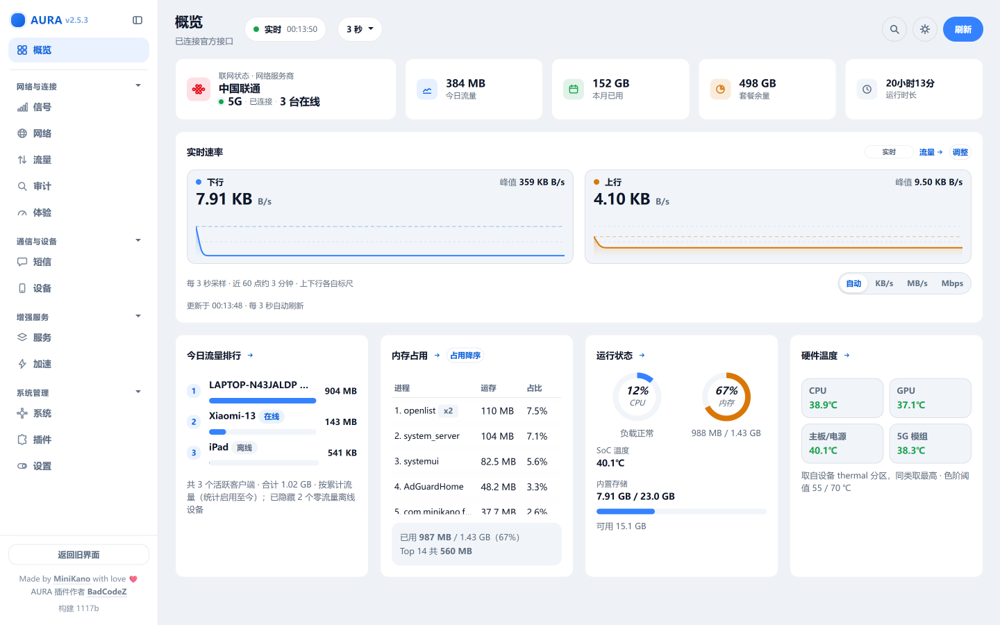
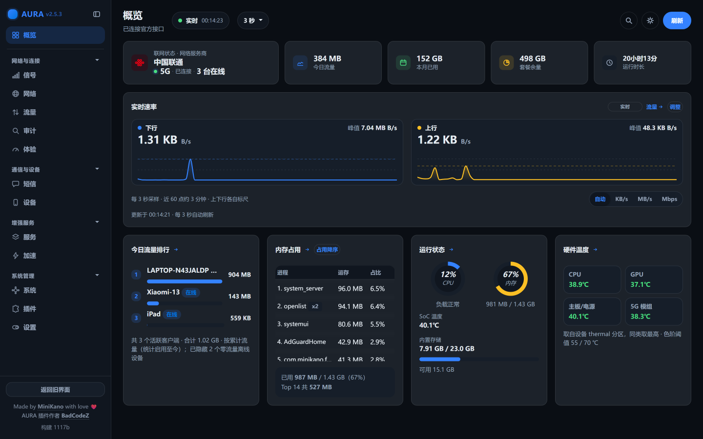
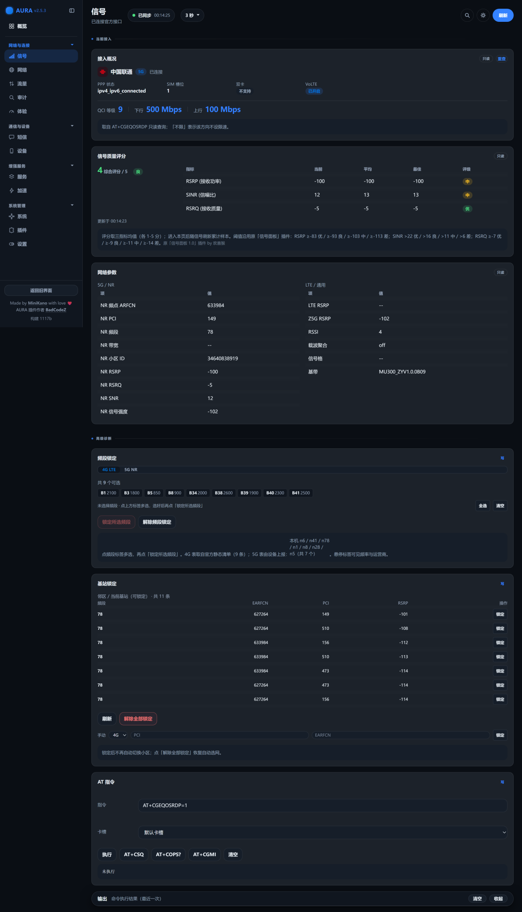
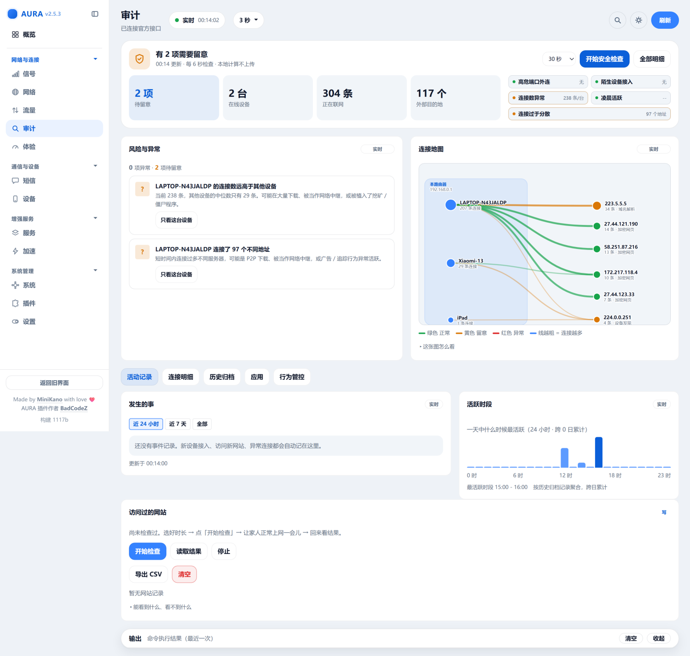
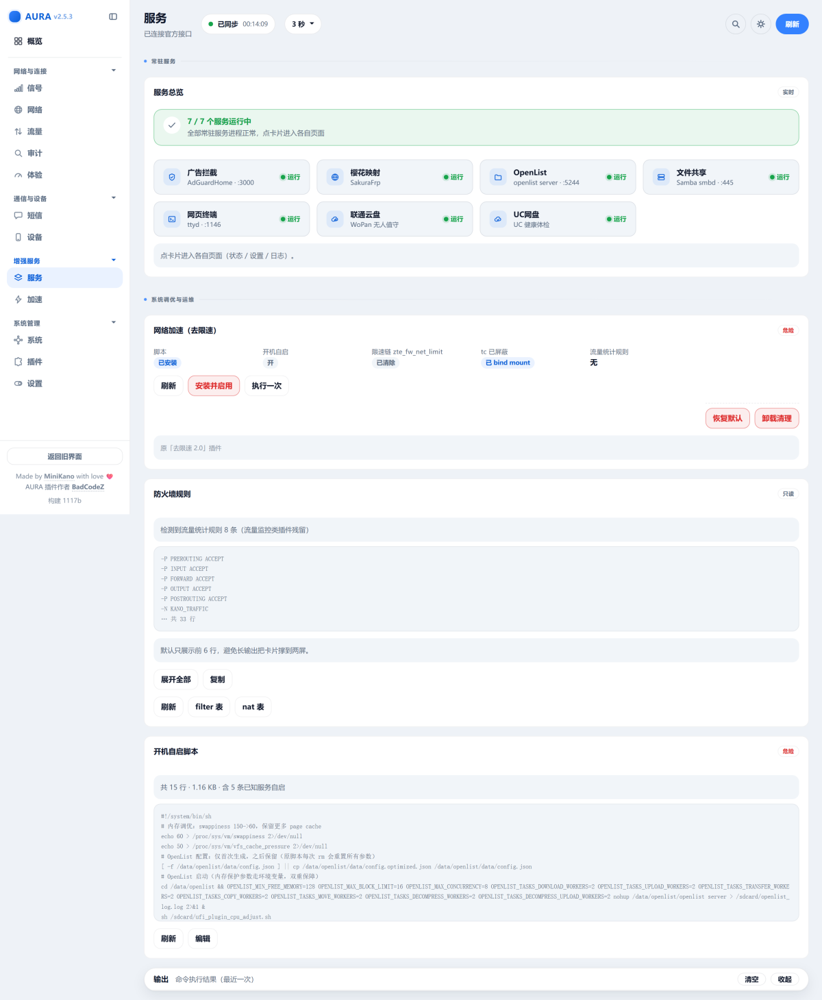
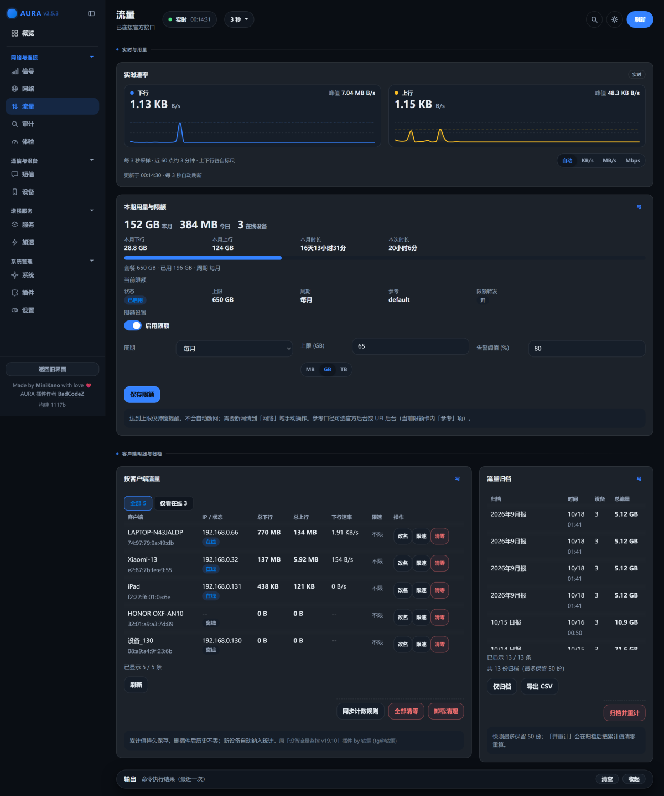
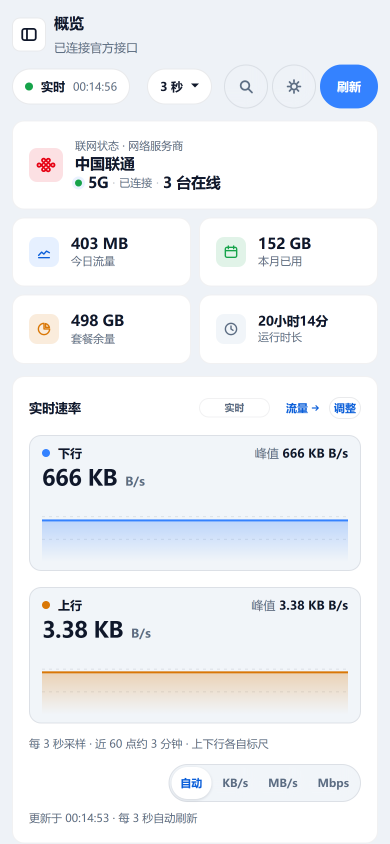
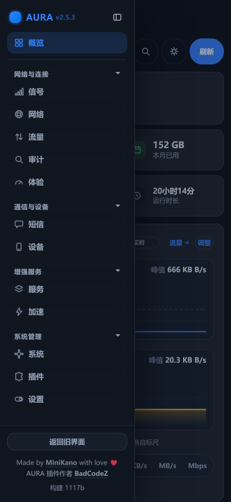

# AURA · UFI-TOOLS 界面增强插件

AURA 是一套**注入式界面插件**，用于 [UFI-TOOLS](https://github.com/kanoqwq/UFI-TOOLS) 设备管理后台。它接管官方页面的渲染，用官方 API 重新组织出 13 个功能域的工作台，把原本分散在多个页面与社区插件里的能力收拢到统一界面中。

- **当前版本**：`v2.5.3`（BUILD `1117b`）
- **适配对象**：UFI-TOOLS 完整版 4.1.x（真机验证于 ZTE F50 / Android 13）
- **形态**：单文件、自包含、零外部依赖
- **许可**：Apache License 2.0（原创部分）



---

## 目录

- [核心特性](#核心特性)
- [界面预览](#界面预览)
- [安装](#安装)
- [兼容性](#兼容性)
- [依赖与前置条件](#依赖与前置条件)
- [目录结构](#目录结构)
- [从源码构建](#从源码构建)
- [诊断接口](#诊断接口)
- [隐私与安全](#隐私与安全)
- [已知限制](#已知限制)
- [更新记录](#更新记录)
- [致谢与许可](#致谢与许可)

---

## 核心特性

### 一体化工作台

13 个功能域，覆盖官方后台的主要能力；其中 5 项能力移植自社区插件并保留原作者署名（见[致谢与许可](#致谢与许可)）：

| 分组 | 功能域 |
|---|---|
| — | 概览 |
| 网络与连接 | 信号、网络、流量、审计、体验 |
| 通信与设备 | 短信、设备 |
| 增强服务 | 服务、加速 |
| 系统管理 | 系统、插件、设置 |

### 自建渲染层

- 不托管、不搬运官方 DOM，用 `/api/*` 直接取数，官方页面整体退场
- 浅色 / 深色双主题，同一套 CSS 变量驱动
- 响应式布局：侧栏在窄屏折叠为抽屉，宽屏按内容宽度自动分栏
- 所有危险操作走二次确认，不静默执行

### 服务托管

AdGuardHome、OpenList、Samba 文件共享、樱花映射、网页终端、联通云盘、UC 网盘——安装、配置、启停、日志在同一处完成。

- 服务状态以**进程归属**为准（比对 `exe` / `cmdline`），不单看端口
- 区分「你主动停止的」与「异常退出的」：前者不计入告警，避免告警疲劳
- 内置开机自启脚本管理，可查看与编辑

### 版别自适应

UFI-TOOLS 存在两条不同 API 内核的产品线。AURA 启动时探测版别：

- 完整版（4.1.x / 4.0.x / 3.9.x）：静默启用全部功能
- 通用版（1.3.x）：顶栏常驻标注「通用版 1.3.x · 部分数据不可用」，并说明原因，避免把版本不兼容误判为插件故障

探测采用**正向判据**（通用版独有端点 `GET /api/currentCellInfo`），而非「某端点不存在」这类反判据——后者会把 3.9.x 与 4.0.0~4.0.3 整段主线误判为通用版。

### 完整回退

一键 `disable` 恢复官方界面，同时保留重新进入插件的入口；卸载走官方段标记剥离，不在 `custom_head` 里留残余。

---

## 界面预览

### 概览（深色）



### 信号（深色）

信号质量评分、NR/LTE 双制式参数、频段锁定、基站扫描、AT 指令合为一页。评分口径为 RSRP / SINR / RSRQ 三指标加权，样本不足时明示而非留 `--`。



### 审计（浅色）

连接地图按客户端聚合外部目的地址，异常项单独成卡，可直接下钻到单台设备。



### 服务（浅色）

服务总览、网络加速、防火墙规则、开机自启脚本四段式排布。



### 流量（深色）



### 移动端

窄屏下侧栏折叠为抽屉，控件按输入方式（`pointer: coarse`）而非屏幕宽度放大到 44px 触控尺寸。

<p>


</p>

---

## 安装

### 方式一：官方插件机制（推荐）

1. 登录 UFI-TOOLS 管理后台（默认 `http://192.168.0.1:2333`）。
2. 进入「插件」页，添加插件，选择 `dist/ufitools-aura-v2.5.3.js`，提交。
3. 刷新页面。AURA 自动启用，无需任何手动开关或配置。

### 方式二：直接注入 `custom_head`

将 `dist/ufitools-aura-v2.5.3.js` 的内容写入后台 `custom_head`。压缩版已包含完整的段标记，可直接整段粘贴。

### 关于两个文件

| 文件 | 体积 | MD5 前 8 | 用途 |
|---|---|---|---|
| `dist/ufitools-aura-v2.5.3.js` | 839,826 B | `cb33c331` | **推荐安装**。CSS 与 JS 均已压缩（terser，仅结构化简，不改字面量） |
| `ufitools-aura-v2.js` | 1,384,815 B | `7a2b423c` | 完整源码，含全部中文注释。保留用于阅读、审计与二次开发 |

两者功能完全一致，仅注释与空白不同。注入使用 `<script id="aura2-engine">` + `<style id="aura2-css">` 两段，遵循官方 `<!-- [KANO_PLUGIN_START] ... [KANO_PLUGIN_END] -->` 块规范，重复注入幂等。

---

## 兼容性

| UFI-TOOLS 版本 | 状态 | 说明 |
|---|---|---|
| 4.1.x（4.1.5 实测） | 完整支持 | 全功能可用，本版基线 |
| 4.0.0 ~ 4.0.3 | 可用 | 缺 VoLTE 开关等 4.0.4 起新增的端点，相关卡片显示空值 |
| 3.9.x | 可用 | 缺部分服务管理与新增端点 |
| 1.3.x 通用版 | 有限支持 | 两套 API 内核不同，多数数据读不到；AURA 会探测并明确提示 |

> 同一包名（`com.minikano.f50_sms`）下存在上述两套内核，这是「同一个 App 装上去有的能读、有的读不到」的根源。判据见上节。

---

## 依赖与前置条件

**插件本体零外部依赖。** 经静态审计与真机验证：

- 无 CDN、无第三方库加载、无外部字体或图标资源
- 无 `eval`、无 `new Function`、无动态脚本注入
- 二维码生成、SHA-256 等能力均以内联实现
- 设备端辅助脚本以 base64 内嵌，首次调用时自动生成，无需手工安装
- 真机首次加载实测：插件自身发起的外部网络请求 **0 条**，脚本错误 **0 个**

需要明确预期的前置条件：

| 类别 | 说明 |
|---|---|
| 运行载体 | 必须运行在 UFI-TOOLS 管理页中（同源 API、`kano_sms_token` 登录态）。作为空 HTML 直接打开不会工作 |
| 登录态 | 从官方页面自动读取 token。未登录时界面照常渲染，但设备数据读不到 |
| 联网类功能 | 「安装 AdGuardHome / OpenList」「在线更新」「内网穿透」本质是把外部程序下载到设备，需要设备联网，部分功能还需要你自己的账号凭据（如 SakuraFrp token） |
| 浏览器 | 设备后台为嵌入式 WebView / 现代浏览器。代码保持 ES5 可解析，未使用可选链等新语法 |

---

## 目录结构

```
.
├── ufitools-aura-v2.js            # 完整源码（单文件，含注释）
├── dist/
│   └── ufitools-aura-v2.5.3.js    # 压缩发布版（推荐安装）
├── docs/
│   ├── AURA-v2.5.3-更新说明.md     # 本版更新说明
│   └── assets/                    # README 截图
├── scripts/
│   └── minify.cjs                 # 压缩脚本
├── LICENSE                        # Apache License 2.0
├── NOTICE                         # 归属声明
└── README.md
```

源码不是纯 JS，而是带段标记的 HTML 片段：

```
<!-- [KANO_PLUGIN_START] ufitools-aura-v2.js -->
<style id="aura2-css"> … </style>
<script id="aura2-engine"> … </script>
<!-- [KANO_PLUGIN_END] ufitools-aura-v2.js -->
```

---

## 从源码构建

```bash
npm install terser
mkdir -p build
node scripts/minify.cjs dist/ufitools-aura-v2.5.3.js
```

脚本默认读取仓库根目录的 `ufitools-aura-v2.js`；输出路径的父目录需已存在。省略参数时输出到 `build/_min_test.js`。

压缩策略：

- JS 走保守压缩集 + mangle，**关闭** `evaluate` 与 `side_effects`——源码含大量 shell 命令字符串与 base64 模板，常量折叠会改写命令结构
- `mangle.reserved` 保留 `VER` / `BUILD` / `DOMAINS` / `SVC_CMD` / `ACTIONS` 等锚点名，外部工具按文本定位
- CSS 只去注释与空行，**不折叠行内空白**——`calc(100% - 10px)` 与 `content:"…"` 均有语义

脚本自带三重自检：语法解析、锚点保留、关键 shell 命令与 CSS 片段原样比对。同一份源码连续压缩两次输出逐字节一致。

---

## 诊断接口

插件在 `window.AURA` 暴露有限的运行时接口，用于排障与集成：

```js
AURA.status()        // 版本、启用态、当前域、主题、token 状态、版别、实时轮询状态
AURA.show('signal')  // 切换到指定域
AURA.refresh(true)   // 手动刷新当前域
AURA.disable()       // 回退官方界面
AURA.enable()        // 重新启用
AURA.setToken('…')   // 手工指定 API token
AURA.swallowed()     // { n, last }：累计条数与最近 30 条被静默收口的异常
AURA.debug(true)     // 开关调试输出
AURA.api.probeEd()   // 重新探测版别
AURA.api.get(path)   // 同源 GET / POST / 表单，自动携带登录态
AURA.viewSet('sms', false)  // 界面模块显隐；AURA.hidden() 读取当前隐藏列表
```

调试模式：地址栏加 `?aura_debug=1`，或控制台执行 `localStorage.aura_debug=1` 后刷新。开启后被静默收口的异常会同时输出到 console。

---

## 隐私与安全

- **口令与散列不进 DOM、不进 localStorage、不进日志**。安全检测只展示状态文案，散列仅用于本机比对指纹
- API token 仅随同源请求发送，不传往任何第三方端点
- 设备名等标识默认脱敏显示，可在设置中关闭
- 商店安装与在线更新采用 **SHA-256 本机首用指纹（TOFU）**：首次安装记录指纹，之后内容变化即阻止安装并提示确认。上游未提供 SHA-256 来源，因此这不是签名验证
- 所有拼接进 shell 的参数统一过 POSIX 单引号转义（`shq()`），不直接拼接用户输入
- 下载地址默认只允许 HTTPS，内网 HTTP 需显式放行；`javascript:` / `data:` 等伪协议直接拒绝

---

## 已知限制

| 项 | 说明 |
|---|---|
| AdGuardHome 默认口令 | 检测链路完整（读 `AdGuardHome.yaml` 的 `users.password` 算指纹并与基线比对），但 v0.107.71 面板无改密入口、设备侧无 bcrypt 工具，因此**不在界面提示用户改密**——那是一个做不到的操作 |
| 通用版 1.3.x | 仅探测与提示，不做只读域适配 |
| 第三方服务 | 云盘、内网穿透等依赖外部账号，插件只提供入口与状态管理 |
| 体积上限 | 设备 `custom_head` 有硬上限，源码已接近阻断线。新增功能需先做减法 |

---

## 更新记录

当前版本 `v2.5.3`，主要变更见 [docs/AURA-v2.5.3-更新说明.md](docs/AURA-v2.5.3-更新说明.md)：

- v2.5.3：修复 OpenList 包内文件名错位导致的安装失败、樱花映射下载源 404 与守护空转；同时修正 ADG 默认口令检测语义并移除无法执行的改密提示（检测能力保留）
- v2.5.2：新增版别探测与通用版友好提示
- v2.5.1：视觉精度打磨——等宽斜杠零、按输入方式而非屏宽适配触控、横滚容器边界、设备名来源徽标、服务停止意图区分

---

## 致谢与许可

- 上游项目 **UFI-TOOLS** — MiniKano（<https://github.com/kanoqwq/UFI-TOOLS>）
- AURA 插件 — BadCodeZ（<https://github.com/BadCodeZ>）

AURA 原创代码与界面采用 **Apache License 2.0** 授权，全文见 [LICENSE](LICENSE)。

上游项目、移植的社区插件与第三方素材的权利与许可**不受此覆盖**：

- 信号质量评分：源自「信号面板 1.0」（欢喜猴）
- 按客户端流量：源自「设备流量监控 v19.10」（钴雮）
- 网络加速：源自「去限速 2.0」
- 樱花映射、OpenList：源自同名插件（OpenList 作者 MiniKano）
- 运营商图标 Arcticons：Donnnno，CC BY-SA 4.0

完整归属声明见 [NOTICE](NOTICE)。
